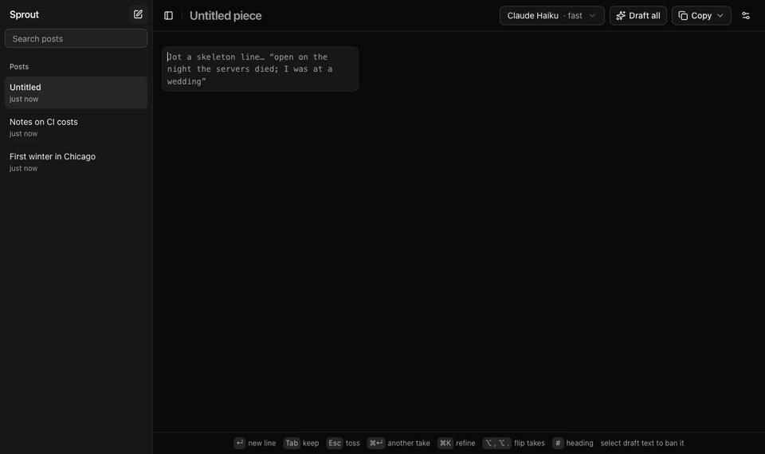

# Sprout

A writing canvas where you jot a skeleton and drafts grow beside it. It runs locally and drafts with **your own Claude or ChatGPT plan** through the `claude` and `codex` CLIs: no API keys, no per-token bill.



<sub>30 seconds, real time apart from two pauses trimmed while drafts finished. [Full-quality MP4](docs/demo.mp4).</sub>

## What it does

- **Outline on the left, drafts on the right.** Type rough lines. When you pause or move to the next line, Sprout reads the whole outline and drafts the lines that need it, streaming each paragraph in beside its line.
- **It won't make things up.** Drafts turn your notes into prose without adding events, scenes, numbers, reasons or promises you didn't give. Title and thesis lines get no paragraph. Thin lines get a hint like *"what went wrong? give me the story"* instead of an invented anecdote.
- **Keep, toss, refine.** `Tab` keeps a draft (then it's yours to edit). `Esc` tosses it, and tossed drafts steer the next take away from them. `⌘↵` asks for a different take, `⌘K` refines it ("shorter", "more concrete", or your own words).
- **Reads like a person wrote it.** 17 built-in checks for known AI tells (em dashes, "it's not X, it's Y", "The result? Chaos.", "serves as", ", highlighting its importance", "X wasn't hard. Y was.", and more), drawn from Wikipedia's [Signs of AI writing](https://en.wikipedia.org/wiki/Wikipedia:Signs_of_AI_writing) and the [tropes.fyi](https://tropes.fyi/directory) catalog. Strong tells are rewritten once automatically; weaker ones are underlined. Add your own banned phrases, or select text in a draft to ban it.
- **Links with previews.** Paste a URL into a line and it gets a preview chip; the model is told what the page is so it can write about it, and keeps your link in the draft. Hover any link for a preview card.
- **Copy anywhere.** Markdown, plain text, rich text (Google Docs, Notion, email), Slack, or an X thread split into 280-character posts. Lines you haven't kept are copied as your own words.
- **Posts.** Multiple posts with search, stored in a local SQLite file.

## Requirements

- [Bun](https://bun.sh) 1.3 or newer
- At least one of:
  - [Claude Code](https://docs.claude.com/en/docs/claude-code) CLI, logged in with a Claude subscription (`claude auth login`)
  - [Codex](https://github.com/openai/codex) CLI, logged in with ChatGPT (`codex login`)

Sprout's settings show whether each CLI is installed and logged in, with the command to fix it if not.

## Run it

```sh
bun install
bun dev        # http://localhost:4747
```

| Key | Action |
| --- | --- |
| `↵` | New line (the line you leave gets drafted) |
| `Tab` | Keep / unkeep the draft |
| `Esc` | Toss the draft |
| `⌘↵` | Another take |
| `⌘K` | Refine |
| `⌥,` `⌥.` | Flip between takes |
| `#` | Start a line with `#` to make it a heading |
| `⌘B` | Toggle the posts sidebar |

Tossed a draft by mistake? The toast has an Undo.

Paste a multi-line outline to split it into lines and draft them all at once.

## How it works

- `src/index.ts` is the server. It spawns `claude -p` (Haiku or Sonnet, streamed) or `codex exec` for each draft, and stores posts and settings in SQLite.
- `src/store.ts` holds the drafting logic: the whole-outline pass, takes, the slop filter and saving.
- `src/App.tsx` is the UI, built with [shadcn/ui](https://ui.shadcn.com), Tailwind and React, and bundled by Bun.

**Keeping plan usage down.** Everything stable (rules, voice notes, banned phrases, paragraphs you've kept) goes in the system prompt, which the Claude CLI caches. Only the outline and the current task change between calls. On a 7k-token document, drafting a second line read 77% of its input from cache. Drafts run at low effort. Whitespace-only edits and empty lines never trigger a call. The server logs each call's tokens and cache hit rate.

## Privacy and safety

- Everything runs on your machine. The server binds to `127.0.0.1` only and rejects cross-origin requests, because it runs CLIs on your account.
- Sprout stores no credentials; login lives in each CLI. Your posts and settings are in `~/.sprout/sprout.db`.
- Link previews are fetched by the local server, which refuses localhost, private and link-local addresses (checked on every redirect).
- Environment variables: `PORT` (default `4747`), `SPROUT_DIR` (default `~/.sprout`), and `SPROUT_DEBUG=1` to save the last model request to `SPROUT_DIR/last-request.json`.

Using your subscription through the official CLIs is subject to your plan's usage limits and terms.

## Development

```sh
bun test           # format conversions + AI-tell detector
bun run typecheck
bun scripts/tell-eval.ts 3 --judge > out.json   # draft 27 paragraphs and score them (uses your plan)
```

The eval drafts a fixed set of outline lines with the app's real prompts, counts AI tells, and with `--judge` asks a second call to list invented material and closing aphorisms. When the prompt was tuned against it, invented details dropped from 80 to 47 across 27 drafts and aphorism endings from 6 to 3, with no surface tells either way.

## License

MIT
